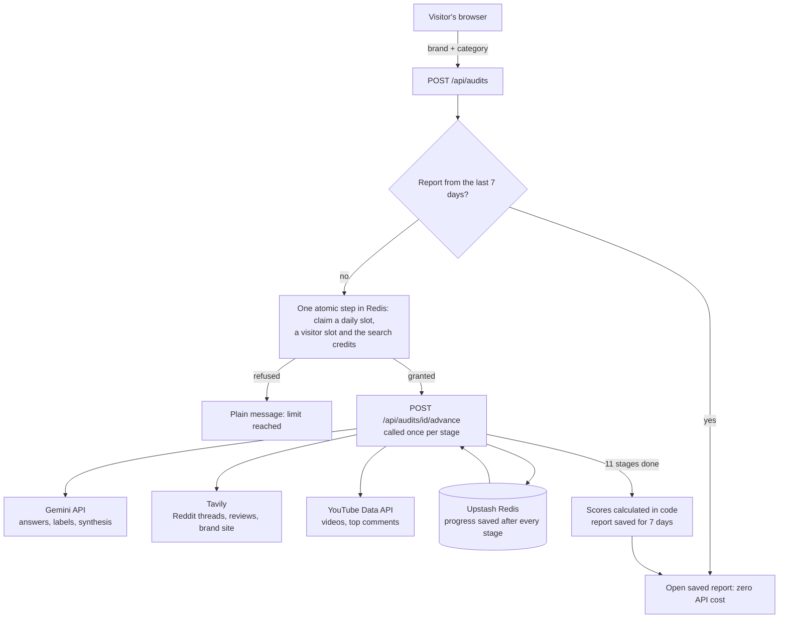

# Shelf Index

**What do people say about your brand, what does AI say about it, and where is the gap?**

Shelf Index is a free, public brand audit. Type a brand, pick a category, and it produces a
report that compares three things: how Google's Gemini model recommends the brand, what real
people say about it, and whether the brand's own website answers what shoppers ask. Every
finding links to the evidence behind it.

Built by [Adyasha Chakra](https://www.linkedin.com/in/adyashachakra).

> **Status: V1, live.** The site is deployed and has completed a real audit end to end.
> See [What was tested](#what-was-tested) for exactly what is proven live and what is only simulated.
> The whole project runs on free tiers with no credit card on any account.

---

## What a report contains

| Section | What it shows |
|---|---|
| Three scores | Gemini API recommendation visibility, audience perception, content gap severity. Each has a confidence level, or says "insufficient data" and why. There is no blended overall score. |
| The disconnect | Where what people say and what Gemini says part ways. |
| Competitor comparison | The three brands Gemini recommended most across the same questions, with a chart and a table. |
| What Gemini says | The eight shopper questions, Gemini's actual answers, and its claims about the brand checked against sources. |
| What people say | Praise themes, complaint themes (each with the number of sources reporting it and whether it concerns one product or the brand), a table separating what was read, what was about the brand and what was counted, advocacy, customer voice vs creator voice, disclosed sponsorship. |
| Content gaps | Which shopper questions the brand's own pages answer clearly, partly, or not at all. |
| Between the lines | Seven patterns a strategist would look for. Each is reported as observed, possible on limited evidence, checked and not observed, or could not be assessed. |
| Prioritised fix list | Up to five actions, each with priority, effort, the evidence it rests on, and a hypothesis to test. No expected result is presented as a measured outcome. |
| Sources and methodology | Every source used, every search run, what was unavailable, and the limitations. |

The metric is deliberately named **Gemini API recommendation visibility**. It measures one Gemini
model through the developer API, without web search. It does not measure every AI assistant and
it does not reproduce the consumer Gemini app.

---

## How it works



An audit is **eleven small stages**, not one long request. The browser asks the server to run
one stage, the server saves the result, and the browser asks for the next. That gives a real
progress display, keeps every request short, and means a refresh or a closed tab only pauses
an audit: nothing is lost and nothing is paid for twice.

1. Prepare the eight shopper questions for the category
2. Ask Gemini each question, one at a time, without naming the brand
3. Ask Gemini what it knows about the brand
4. Find customer discussions and independent reviews (Tavily)
5. Sample YouTube videos and top comments (official API)
6. Label the evidence: who is speaking, what sentiment, which themes
7. Read the brand's own website (pages a search surfaces)
8. Check Gemini's claims against sources
9. Compare with the top three competitors
10. Find the disconnect and draft the fix list
11. Calculate the scores and assemble the report

---

## The three scores

All three are calculated in code from labelled evidence. The AI model labels and summarises;
it never produces a score.

### 1. Gemini API recommendation visibility (0 to 100, higher is better)

For each counted question the brand earns a credit by where Gemini placed it:

| Placement | 1st | 2nd | 3rd | 4th | 5th | 6th or later | Named, not recommended | Absent or cautioned against |
|---|---|---|---|---|---|---|---|---|
| Credit | 1.00 | 0.85 | 0.70 | 0.55 | 0.45 | 0.35 | 0.20 | 0 |

`score = round(100 × total credit ÷ counted questions)`

- A question is **excluded** as outside the brand's range in two cases only, the same in every category:
  1. **Kind of product.** The brand's own site shows it does not sell that kind of product (at
     least three readable pages, at least one product line confirmed by a quote found on the page).
  2. **Price tier.** The question asks about one price tier ("luxury brands", "affordable
     brands") and at least **two independent sources** say in words that the brand sits in the
     other one. The words must be found in the source and must be about the brand. Pages count by
     website: several pages of one domain are one source, and a subdomain of the brand's own domain
     is the brand's own site. The brand's own site can be one of the two, but a second, different
     domain is needed, and **at least one of the sources must be independent of the brand**: a
     press release, a corporate announcement or other company material (including a parent
     company's) never counts. If independence cannot be shown, the price position stays
     unestablished and the question counts. A YouTube viewer comment never counts. Gemini's own opinion of the brand's
     price level is never used. With one source the question counts, and the report says the price
     tier is insufficiently supported. If the sources disagree, or none states it, the question counts.

  A question about a price tier is decided by the price rule alone. The model's own opinion
  that a brand "is not positioned as luxury" excludes nothing, and a kind-of-product verdict
  whose reason talks about price is ignored.

  In both cases Gemini must also not have named the brand in that answer: if it did, the
  question counts. At most three exclusions per audit. An excluded question is listed in the
  report with its reason and its source.
- A question Gemini failed to answer is **missing data**. It is never counted as zero.
- Fewer than five counted questions: no score.
- Confidence: high = 8 counted, medium = 6 or 7, low = 5.

### 2. Audience perception (0 to 100, higher is better)

Counted opinions are relevant, not written by the brand, and not neutral. Customers count 1.0;
creators, publications and unclear voices count 0.5.

`score = round(100 × (positive + 0.5 × mixed) ÷ (positive + mixed + negative))`, using those weights.

- Raw counts and weighted counts are reported separately.
- Unique source domains are reported separately from source types (customer, creator, publication).
- Sponsored content is flagged where it is disclosed (YouTube's paid-promotion flag, or disclosure wording).
- Fewer than 8 counted opinions, or fewer than 3 distinct sources: no score.
- Confidence: high = 25+ opinions, 4+ domains and 2+ source types; medium = 12+ opinions and 2+ domains; otherwise low.

### 3. Content gap severity (0 to 100, **higher is worse**)

The checklist is the in-range shopper questions plus up to four recurring customer concerns.
Not addressed = 1 point, partly = 0.5, clearly = 0.

`score = round(100 × points ÷ checklist size)`

- "Clearly" or "partly" must cite a retrieved page and a quote found on that page. If the quote
  cannot be found, the item is downgraded one level.
- **The quote must be about what the item asks.** Each verdict is checked for the product or
  category it concerns. A reader sees one of four classes: *answered clearly* (the same product, or
  a fact about the whole brand), *touched on* (related but incomplete), *not addressed* (the page
  is about a different product: a lotion quote does not answer a cleanser question, even from the
  same brand) and *uncertain* (the link cannot be confirmed). Only direct and brand-wide evidence
  can earn "clearly". For a question about what experts recommend ("which brands do dermatologists
  recommend?"), the quote must show experts *recommending or endorsing* the brand **and name who does**
  (a named person such as "Dr. ..." or an organisation such as an academy, association or foundation).
  The brand's own "dermatologist recommended" with nobody named is the brand's *claim*: it is shown as
  that, never as an independently verified endorsement, and counts as "touched on". Even a named
  expert is quoted from the brand's own page, and the report says the audit did not check it against
  an independent source. A quote saying experts helped make or test the products (*collaboration*)
  is also only "touched on", and a quote that does not mention experts at all is uncertain. Two more
  quote checks work the same way (word lists applied to the quote the analysis already returned, no
  extra request): for a "which is best for ..." question, a quote that only says the product *suits a
  range of types* is "touched on", not a clear answer; for an availability question ("available
  outside the United States or in Europe?"), a quote must say where products are available, and a
  notice about the visitor's location counts as "not addressed". Evidence about another product is "not addressed" (1 point), so it never lowers the
  gap. An *uncertain* item, and an item for which the analysis returned no verdict at all, is **left out of
  the content gap score** and the score's confidence is lowered one level, with a warning in the report: a
  missing or incomplete model answer is not proof that the site fails to address the question. The formula is
  unchanged; it simply runs on the items that could be assessed (and still needs at least 4 of them). The check uses two things the code can
  verify (the product the model names appears in the quoted words or the page title, and a short
  word list of common product types) plus the model's own statement of how the evidence relates to
  the question. The word list is not comprehensive: for products it does not list, the model's
  statement decides, and a missing statement makes the item uncertain.
- **Product range** is reported in three states: *products identified in the pages read* (at least
  one product line confirmed by a quote from a page), *partially assessed* (product information was
  found, none could be confirmed) and *could not be assessed*. The report shows the real number of
  pages read and products identified, and says these are not a verified inventory of the brand's
  complete range.
- No score if the site could not be identified, fewer than 3 pages were readable, or the
  checklist has fewer than 4 items.
- Confidence: high = 8+ pages across 3+ site sections; medium = 5+ pages across 2+ sections; otherwise low.

**No overall score.** Overall confidence is the lowest of the three and is stated only when all
three were scored.

---

## Evidence rules

- Every theme, insight and recommendation the model proposes must cite evidence ids that exist
  in this audit. Anything citing nothing real is dropped.
- Every quote is checked against the text that was actually retrieved. A quote that cannot be
  found is removed.
- A claim about the brand is marked supported or contradicted only when a quote from a source
  backs the verdict **and that quote is about the brand**: it comes from the brand's own site,
  from a page whose title names the brand, or from a passage that names the brand. A sentence
  that could be about any brand leaves the claim "unverified". A claim about the brand's price
  level ("affordable", "luxury") also needs that price level in the quoted words: a comparison
  such as "slightly cheaper" does not support it.
- Every count of sources shown in a report is made in code from the evidence cited. The model
  is told not to count, and any "across N sources" it writes anyway is removed, because in live
  runs its counts disagreed with the evidence it cited.
- If the analysis of the brand's site returns no verdict for a checklist item, the item is
  still counted as "not addressed" (the formula is unchanged), and the report says how many
  items that happened to, because a missing verdict is not the same as a page that fails to answer.
- A complaint or praise theme states how many separate sources report it and whether it is
  about one named product or the brand in general. A theme is a count of this sample. It is
  never presented as how common an experience is, or as a safety or quality finding.
- **Causes and business outcomes are screened, not guaranteed absent.** The audit measures no
  sales, conversion, loyalty or trust. The model is told not to state causes, generalise from a
  few reports or promise results. Its sentences about complaints, implications and
  recommendations then pass through a wording screen: text matching a known overclaiming
  phrasing is replaced by a plain statement, a recommendation whose action matches is dropped,
  and a cause is kept only where the sentence attributes it to the customers who said it
  ("two customers attribute this to..."). **The screen is a list of words and phrases. It is
  not a detector of every unsupported causal claim**: a cause worded in a way the list does not
  know will pass, and the attribution test is a word match. Every report says this in its
  stated limits, and every interpretation sits beside the evidence it rests on so a reader can check it.
- Every expected result in the fix list is shown as a **hypothesis to test**, with a count of
  the evidence it rests on.
- **Between the lines is graded by evidence.** A pattern that depends on customer complaints is
  called observed only with five or more separate sources; with fewer it reads "possible
  pattern" or "potential tension, limited evidence". Whether Gemini knows the brand for a single
  product is counted from **two separate lists that are never merged**: Gemini's list (what the
  model says the brand sells when asked; its own account, not checked against the site) and
  the site's range (product lines found on the brand's own pages, each confirmed by a quote; a
  sample of the site). The report names both lists and shows them side by side. Which sources
  Gemini relies on **cannot be assessed** by this audit (its answers carry no citations), so
  that check always says so and shows only what was measured.
- When a pattern cannot be established, the report says "not observed" or "could not be
  assessed". It does not invent an explanation.
- Reports label what is calculated and what is an AI model's interpretation.

---

## Staying at $0

| Guard | How |
|---|---|
| New audits per day | `DAILY_SCAN_LIMIT` (default 2), enforced atomically |
| Per visitor per day | `PER_VISITOR_DAILY_LIMIT` (default 1), by a one-way hash of the IP address |
| Tavily credits per month | `TAVILY_MONTHLY_CREDIT_CEILING` (default 800 of the 1,000 free). Credits are **reserved** before an audit starts and unused ones are returned when it ends |
| Simultaneous visitors | One Lua script claims the daily slot, the visitor slot and the credits together. A refused request writes nothing |
| Repeat requests | Same brand + category within 7 days opens the saved report. A second request for a brand already running joins that audit |
| Research depth | Full = 9 searches, reduced = 5, minimal = 3. The depth drops automatically if the month's budget is running low |
| Search cost | Always Tavily "basic" depth (1 credit). Never "advanced" |
| Gemini pacing | `GEMINI_RPM` and `GEMINI_RPD` come from your own AI Studio rate-limit page. Nothing is assumed |
| Exhausted quota | The audit stops or pauses with a plain message. No paid request is ever made, and no account has billing enabled |
| Paid features | No Search grounding. No paid APIs. No SDKs that could switch plans |

If a quota runs out, the worst case is that new audits pause until it resets. Saved reports
and the example report keep working.

---

## Project map

```
app/                      Pages and API routes (Next.js App Router)
  page.tsx                Landing page with the audit form
  audit/[id]/page.tsx     Live progress while an audit runs
  report/[id]/page.tsx    A finished report
  example/page.tsx        A fictional, clearly labelled example report
  privacy/page.tsx        Privacy and data: what each service receives and keeps
  api/audits/route.ts               Start an audit (or return a saved/running one)
  api/audits/[id]/advance/route.ts  Run the next stage
  api/audits/[id]/route.ts          Read progress or the finished report as JSON
  api/health/route.ts               Setup self-check (never returns a secret)

components/               What you see
  AuditForm.tsx           The form on the landing page
  AuditProgress.tsx       The stage-by-stage progress display
  report/                 One file per report section, plus the Recharts chart

lib/                      The engine (server only; none of this reaches the browser)
  config.ts               Every tunable number and all user-facing limit messages
  types.ts                The shape of a report and everything in it
  categories.ts           The category list
  audit/pipeline.ts       Starts audits and runs one stage per request
  audit/context.ts        Shared tools for stages: paced Gemini calls, budgeted searches
  audit/stages/           The eleven stages, one file each
  audit/questions.ts      The fixed eight questions per category (edit these freely)
  audit/prompts.ts        Every instruction sent to Gemini, with its expected output shape
  scoring/                The three formulas, confidence levels, competitor ranking
  evidence/               Brand-name matching, quote verification, sponsorship detection,
                          price-tier evidence (price.ts), the check on overclaiming wording (overclaim.ts)
  report/                 Turns stored evidence into the final report; the example report
  quota/scripts.ts        The Lua scripts that make limits atomic
  quota/reservations.ts   Reserve, spend, return and sweep search credits
  quota/gemini-limiter.ts Paces Gemini to the limits you configure
  clients/                Small fetch-based clients for Gemini, Tavily, YouTube, Upstash
  cache/                  Saved reports and in-progress audits
  validation/             Checks on user input and on everything the model returns
  log.ts                  Logging that redacts keys and never logs API content
  throttle.ts             A speed bump against scripts hammering the start endpoint

tests/                    See "What was tested"
```

---

## Environment variables

Set these in Vercel (Project > Settings > Environment Variables). Never put values in GitHub.

| Name | Required | What it is |
|---|---|---|
| `GEMINI_API_KEY` | yes | Google AI Studio key (free tier) |
| `TAVILY_API_KEY` | yes | Tavily key (free plan) |
| `UPSTASH_REDIS_REST_URL` | yes | From the Upstash database page |
| `UPSTASH_REDIS_REST_TOKEN` | yes | From the Upstash database page |
| `YOUTUBE_API_KEY` | recommended | Without it, audits run without YouTube |
| `GEMINI_RPM` | recommended | Requests per minute for your model, from your AI Studio rate-limit page |
| `GEMINI_RPD` | recommended | Requests per day for your model, from the same page |
| `GEMINI_MODEL` | optional | Default `gemini-3.5-flash-lite` (see [Which Gemini model, and why](#which-gemini-model-and-why)) |
| `DAILY_SCAN_LIMIT` | optional | Default 2 |
| `PER_VISITOR_DAILY_LIMIT` | optional | Default 1 |
| `TAVILY_MONTHLY_CREDIT_CEILING` | optional | Default 800 |
| `CACHE_DAYS` | optional | Default 7 |
| `QUOTA_TIMEZONE` | optional | Default `America/Los_Angeles` (when Google's daily quotas reset) |

Step-by-step deployment for a first-timer is in [DEPLOY.md](./DEPLOY.md).

---

## Which Gemini model, and why

V1 was planned around `gemini-3.8-flash`. The live site runs `gemini-3.5-flash-lite` instead,
for one reason: the free allowance.

| Model | Free requests per minute | Free requests per day | Audits per day (about 18 requests each) |
|---|---|---|---|
| Gemini 3.8 Flash | 5 | 20 | 1 at most, with nothing to spare for a retry |
| Gemini 3.5 Flash-Lite | 15 | 500 | far more than the site's own daily cap |

These numbers were read from the AI Studio rate-limit page of the Google project behind this
site on 14 November 2026. Limits belong to a project and Google changes them, so check your own
page before deploying a copy. The project has no billing account, and the first real audit
completed on it, which is the practical proof that the model is served on the free tier.

What this costs: Flash-Lite is a smaller model than 3.8 Flash. The visibility score describes
**the model named in the report and no other**. Every report shows the model name the API
itself reported, the name the site asked for, and a one-line note on why.

To use a different model, set `GEMINI_MODEL` together with that model's own `GEMINI_RPM` and
`GEMINI_RPD`. Nothing else changes.

---

## What was tested

"Simulated" means canned responses shaped like each API's documentation. It proves the engine's
logic, not that the live service behaves the same way.

### Proven live (14 and 15 November 2026)

- `next build` on Vercel passed on the first deployment of V1.0, and again for V1.1 on a
  Preview deployment built from a separate branch. The V1.1 build log has three warnings, all
  npm notices and none from this project's code. The V1.0 build shows the same number.
- `/api/health` returned `ok: true` on both: every key present, Redis reachable, the Lua
  scripts running, and the configured Gemini model available. (It does not call Tavily or
  YouTube. Those were proven by the audits themselves.)
- V1.0, one real audit (Cetaphil, skincare): start to finish in about a minute, 16 Gemini
  requests, 9 search credits, 14 pages of the brand's site, 4 YouTube videos and 32 comments,
  no warnings.
- V1.1, one real audit of the same brand on the Preview: about 75 seconds, 18 Gemini requests,
  9 search credits, no warnings. Every Gemini call was accepted in the first structured-output
  format. Two transient failures from Gemini (one "unavailable", one per-minute rate limit)
  were retried and recovered without failing the audit: the first live proof of those two paths.
- That run confirmed, on real output: the brand name's capitalisation, the read / about the
  brand / counted table, the two-list product-range check, "could not be assessed" for the
  sources Gemini relies on, the "potential tension, limited evidence" grading, hypotheses in
  the fix list, and the model line in the methodology.

### What the first live V1.1 run got wrong, and what was changed

- The luxury question was left out, but for the wrong stated reason: the model called it "out
  of range" because of how the brand is positioned, and the code accepted that under "kind of
  product". Price-tier questions are now decided by the price rule alone.
- Two recommendations stated a number of sources that disagreed with the count made in code.
  The model is no longer asked to count, and its counts are removed.
- A price claim ("affordable") was marked supported on a comparison ("slightly cheaper"). Price
  claims now need the price level in the quoted words.

These three corrections pass the simulated tests. Their own live run is the next audit on the Preview.

### Not yet proven live

- Patch 3 (two-source price rule, the four evidence classes, product-range states, single-audit
  wording). Tested with simulated services only. The product-relevance check in particular depends
  on the model filling in three new fields in the existing site-analysis request; if it does not,
  items are reported as uncertain, left out of the score and the confidence is lowered, with a warning.
- The three corrections listed just above.
- Patch 4 (independent-source rule for price tiers, expert collaboration vs endorsement vs
  recommendation, reading of format 2 reports). Tested with simulated services and with real
  saved reports of formats 2, 3 and 4; the live Cetaphil result under these rules has not been run.
- Patch 5 (best-for questions answered only by general suitability, availability questions answered
  by a location notice, a brand's own "dermatologist recommended" claim versus a named expert, source
  counts in recommendations, the corrected builder credit). Tested with the real quotes from the first
  V1.1 report and with simulated services; no live audit has run under these rules. Known limits: the
  rules are word lists, so a phrasing they do not know is left as the analysis judged it (for example a
  named expert organisation whose name contains no expert word is read as no expert reference and left
  out of the score, the safe direction). A denied recommendation ("doctors do not recommend this
  brand", "not recommended by dermatologists", "no dermatologist endorses it") is read as a denial and
  counts as "not addressed", never as a recommendation; denials worded in ways the list does not know
  are not caught. Reports already saved are shown as they were and are not rewritten.
- Whether content gap severity is stable from run to run. The two Cetaphil audits, about two
  hours apart on the same model, gave 55 and 78. The formula, the instruction for this step and
  the code that fetches the brand's pages were the same in both. The search returned different
  pages (5 of the 14 were the same), but that does not explain the change: for at least one
  question, the page and the sentence that earned "partly answered" in the first run were read
  again in the second, which still came back "not addressed". All seven counted shopper
  questions came back that way in the second run. A saved report cannot show whether the model
  judged them so or left them out of its answer (both versions count a missing verdict as "not
  addressed"), nor whether what V1.1 changed elsewhere in the same request played a part (one
  task reworded, one added). Three things were changed in response. None touches the formula
  or adds a request: the instruction now names every checklist item, the report flags any item
  for which no verdict came back, and the runtime log records how many verdicts were asked for
  and how many were returned (counts and item ids only).
- Failure paths other than the two above: an exhausted daily quota, YouTube being down.
  These are covered by simulation only.

### Automated checks

| Area | How it was checked | Real or simulated |
|---|---|---|
| Scoring formulas, confidence levels, insufficient-data states | 17 unit tests | Real code, no services needed |
| Atomic limits: simultaneous visitors, rollback, credit return, overcharge, stale sweep | 9 tests running the project's Lua scripts | **Real Redis server**, through a local stand-in for Upstash's HTTP layer |
| A whole audit start to finish, including failures (format rejected, rate limit, missing answer, YouTube down, comments disabled, Tavily quota hit), caching, duplicates, limits, key redaction in logs, and model answers that overclaim on purpose | 12 tests | Real Redis; Gemini, Tavily and YouTube **simulated** |
| The four API routes as HTTP handlers | 6 tests | Real handlers, real Redis, simulated APIs |
| Evidence rules: price-tier relevance in every category, quotes about the brand, brand capitalisation, graded patterns, wording that overclaims | 12 tests | Real code, no services needed |
| Patch 3: two independent price sources and registrable domains, the four evidence classes (including a different-product quote), items left out of the score, the three product-range states | 19 + 5 tests | Real code, no services needed |
| Patch 4: independence of price sources (press releases, parent-company material, brand site plus one independent source), expert collaboration vs endorsement vs recommendation | 13 tests | Real code, no services needed |
| Patch 5: the cleanser, availability and dermatologist cases with the real quotes, source counts (unique sources versus excerpts), the builder credit spelling | 19 tests (including denied recommendations), plus a footer check on every rendered page | Real code, no services needed |
| Saved reports across format changes: real format 2, 3 and 4 reports open and the API returns exactly what was saved; nothing missing is invented; format 1 is not read; old cached reports are not reused | 8 tests | Real Redis, real route handler |
| TypeScript, engine and API routes | Strict compile, zero errors | Real compiler |
| TypeScript, pages and components | Strict compile with stand-in typings for React, Next.js and Recharts | Partial locally; the real check is the Vercel build |
| Every page renders: the example, an all-"insufficient data" report, a report produced by the engine in the tests, and real saved reports of formats 2, 3 and 4 | Server-rendered to HTML and screenshotted at desktop and phone widths | Stand-ins for Next.js and Recharts |

To run the tests yourself (optional, needs Node.js and a local Redis server on port 6399):
`npm install`, then `npm test`.

---

## Known limitations

- Scores are estimates from a sample of public information at one moment. They are not a census.
- Each question is put to Gemini once. AI answers vary between runs.
- One Gemini model, through the API, without web search. Not the Gemini app, not other assistants.
- Reddit content comes only from threads a web search service surfaced. Reddit, Instagram and
  TikTok are never accessed directly.
- YouTube comments are a small sample of top comments on a few videos.
- The content gap is judged from pages a search surfaced, not a full crawl of the brand's site.
- Sponsorship is flagged only where disclosed. Undisclosed sponsorship cannot be detected.
- A complaint theme shows that some customers reported something. It does not show how common
  that is, and it is not evidence of a safety or quality problem.
- No sales, conversion, loyalty or trust data is measured. Implications and expected results
  are hypotheses.
- Two sources are independent only if they are on different registrable domains: `brand.com`,
  `shop.brand.com` and `www.brand.com` are one, and so is any other domain the audit found to belong to
  the brand. The rule is plain string handling with a short built-in list of common endings such as
  `co.uk` and of shared hosts such as `blogspot.com`; it is not a full public-suffix list.
- **What counts as an independent price source, and what this rule cannot know.** The brand's own
  site may be one source. Any other source must not be the brand's, and must not be company
  material. A source is set aside as company material when: it is on a press-release wire service
  (`prnewswire.com`, `businesswire.com` and similar); its address is under a press or newsroom path,
  or under a news path with an announcement headline ("... Unveils ...", "... Launches ..."); or the
  brand's own pages name that company as owner, publisher or copyright holder ("(c) Galderma", "a
  brand of ..."). The rule is plain string checks: no lookup, no search, no extra request, no package.
  It **cannot** discover a parent company or subsidiary the brand's pages do not name, and it cannot
  recognise an advertorial or sponsored article that looks like an ordinary one. Such a source is
  treated as independent. In the other direction, a genuine news article with an announcement-style
  headline under a news path is set aside, so the price position stays unestablished (the safe
  direction). Set-aside sources are listed in the report with the reason.
- A question is left out on price only when two websites state the brand's price tier in words,
  at least one of them independent of the brand. With one source, a budget brand is still counted on the "luxury" question and the
  report says the tier is insufficiently supported. This audit does not retrieve prices or retailer
  listings, so it cannot confirm a price tier from numbers.
- Scores are single-audit estimates. Running the same audit again can give different scores,
  because the sources found and the model's reading of them change. No margin is given: the
  variation has not been measured well enough to state one.
- The audit cannot see which sources Gemini draws on. It can only count where the brand is discussed.
- The wording screen is a list of words and phrases. It removes the overclaims it recognises and
  misses those it does not. It is not comprehensive detection of unsupported causal claims,
  which is why every report states these limits and shows the evidence beside each interpretation.
- The product-range check compares two lists of different kinds: product types in Gemini's own
  words, and line names found on a sample of the brand's pages. It can show that Gemini named
  one product or several. It cannot show that every line on the site is recognised.
- Competitor sentiment comes from one search per competitor. Competitor content coverage is not measured.
- The per-visitor limit uses the IP address, so people sharing a network share one allowance.
- The request speed bump lives in server memory. A determined script could still use up the
  free Redis command allowance; the result would be a pause until the monthly reset, never a charge.
- Usage is small by design: a couple of new audits a day. This is a portfolio tool on free quotas.

## Roadmap (not in V1)

Instagram via Meta Business Discovery, TikTok Research API, bring-your-own-key for ChatGPT,
Claude and Perplexity, shareable report links, category leaderboards, history over time.

## Stack

Next.js (App Router) · TypeScript · Tailwind CSS · Recharts · Gemini API · Tavily API ·
YouTube Data API · Upstash Redis · Vercel Hobby
