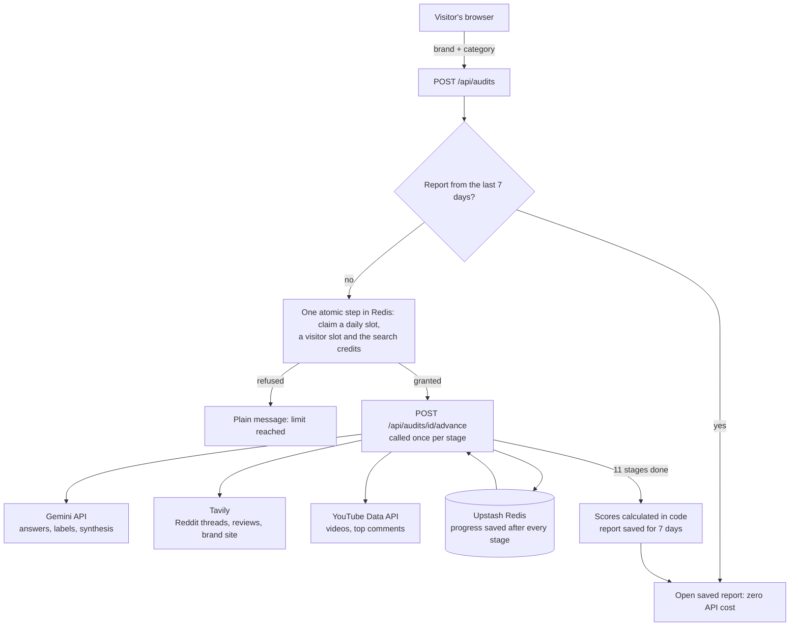

# Shelf Index

**What do people say about your brand, what does AI say about it, and where is the gap?**

Shelf Index is a free, public brand audit. Type a brand, pick a category, and it produces a
report that compares three things: how Google's Gemini model recommends the brand, what real
people say about it, and whether the brand's own website answers what shoppers ask. Every
finding links to the evidence behind it.

Built by [Adya Chakra](https://www.linkedin.com/in/adyashachakra).

> **Status: V1.** The audit engine is tested (see [What was tested](#what-was-tested)).
> The whole project runs on free tiers with no credit card on any account.

---

## What a report contains

| Section | What it shows |
|---|---|
| Three scores | Gemini API recommendation visibility, audience perception, content gap severity. Each has a confidence level, or says "insufficient data" and why. There is no blended overall score. |
| The disconnect | Where what people say and what Gemini says part ways. |
| Competitor comparison | The three brands Gemini recommended most across the same questions, with a chart and a table. |
| What Gemini says | The eight shopper questions, Gemini's actual answers, and its claims about the brand checked against sources. |
| What people say | Praise themes, complaint themes, advocacy, customer voice vs creator voice, disclosed sponsorship. |
| Content gaps | Which shopper questions the brand's own pages answer clearly, partly, or not at all. |
| Between the lines | Seven patterns a strategist would look for. Each is reported as observed, not observed, or cannot be assessed. |
| Prioritised fix list | Up to five actions, each with priority, effort, expected impact and supporting evidence. |
| Sources and methodology | Every source used, every search run, what was unavailable, and the limitations. |

The metric is deliberately named **Gemini API recommendation visibility**. It measures one Gemini
model through the developer API, without web search. It does not measure every AI assistant and
it does not reproduce the consumer Gemini app.

---

## How it works



An audit is **eleven small stages**, not one long request. The browser asks the server to run
one stage, the server saves the result, and the browser asks for the next. That gives a real
progress display, keeps every request short, and means a refresh or a closed tab only pauses
an audit: nothing is lost and nothing is paid for twice.

1. Prepare the eight shopper questions for the category
2. Ask Gemini each question, one at a time, without naming the brand
3. Ask Gemini what it knows about the brand
4. Find customer discussions and independent reviews (Tavily)
5. Sample YouTube videos and top comments (official API)
6. Label the evidence: who is speaking, what sentiment, which themes
7. Read the brand's own website (pages a search surfaces)
8. Check Gemini's claims against sources
9. Compare with the top three competitors
10. Find the disconnect and draft the fix list
11. Calculate the scores and assemble the report

---

## The three scores

All three are calculated in code from labelled evidence. The AI model labels and summarises;
it never produces a score.

### 1. Gemini API recommendation visibility (0 to 100, higher is better)

For each counted question the brand earns a credit by where Gemini placed it:

| Placement | 1st | 2nd | 3rd | 4th | 5th | 6th or later | Named, not recommended | Absent or cautioned against |
|---|---|---|---|---|---|---|---|---|
| Credit | 1.00 | 0.85 | 0.70 | 0.55 | 0.45 | 0.35 | 0.20 | 0 |

`score = round(100 × total credit ÷ counted questions)`

- A question is **excluded** only when the brand's own site shows it does not sell that kind of
  product (at least three readable pages, at least one product line confirmed by a quote found
  on the page) **and** Gemini did not name the brand in that answer. At most three exclusions.
- A question Gemini failed to answer is **missing data**. It is never counted as zero.
- Fewer than five counted questions: no score.
- Confidence: high = 8 counted, medium = 6 or 7, low = 5.

### 2. Audience perception (0 to 100, higher is better)

Counted opinions are relevant, not written by the brand, and not neutral. Customers count 1.0;
creators, publications and unclear voices count 0.5.

`score = round(100 × (positive + 0.5 × mixed) ÷ (positive + mixed + negative))`, using those weights.

- Raw counts and weighted counts are reported separately.
- Unique source domains are reported separately from source types (customer, creator, publication).
- Sponsored content is flagged where it is disclosed (YouTube's paid-promotion flag, or disclosure wording).
- Fewer than 8 counted opinions, or fewer than 3 distinct sources: no score.
- Confidence: high = 25+ opinions, 4+ domains and 2+ source types; medium = 12+ opinions and 2+ domains; otherwise low.

### 3. Content gap severity (0 to 100, **higher is worse**)

The checklist is the in-range shopper questions plus up to four recurring customer concerns.
Not addressed = 1 point, partly = 0.5, clearly = 0.

`score = round(100 × points ÷ checklist size)`

- "Clearly" or "partly" must cite a retrieved page and a quote found on that page. If the quote
  cannot be found, the item is downgraded one level.
- No score if the site could not be identified, fewer than 3 pages were readable, or the
  checklist has fewer than 4 items.
- Confidence: high = 8+ pages across 3+ site sections; medium = 5+ pages across 2+ sections; otherwise low.

**No overall score.** Overall confidence is the lowest of the three and is stated only when all
three were scored.

---

## Evidence rules

- Every theme, insight and recommendation the model proposes must cite evidence ids that exist
  in this audit. Anything citing nothing real is dropped.
- Every quote is checked against the text that was actually retrieved. A quote that cannot be
  found is removed.
- A claim about the brand is marked supported or contradicted only when a quote from a source
  backs the verdict. Otherwise it stays "unverified".
- When a pattern cannot be established, the report says "not observed" or "cannot be assessed".
  It does not invent an explanation.
- Reports label what is calculated and what is an AI model's interpretation.

---

## Staying at $0

| Guard | How |
|---|---|
| New audits per day | `DAILY_SCAN_LIMIT` (default 2), enforced atomically |
| Per visitor per day | `PER_VISITOR_DAILY_LIMIT` (default 1), by a one-way hash of the IP address |
| Tavily credits per month | `TAVILY_MONTHLY_CREDIT_CEILING` (default 800 of the 1,000 free). Credits are **reserved** before an audit starts and unused ones are returned when it ends |
| Simultaneous visitors | One Lua script claims the daily slot, the visitor slot and the credits together. A refused request writes nothing |
| Repeat requests | Same brand + category within 7 days opens the saved report. A second request for a brand already running joins that audit |
| Research depth | Full = 9 searches, reduced = 5, minimal = 3. The depth drops automatically if the month's budget is running low |
| Search cost | Always Tavily "basic" depth (1 credit). Never "advanced" |
| Gemini pacing | `GEMINI_RPM` and `GEMINI_RPD` come from your own AI Studio rate-limit page. Nothing is assumed |
| Exhausted quota | The audit stops or pauses with a plain message. No paid request is ever made, and no account has billing enabled |
| Paid features | No Search grounding. No paid APIs. No SDKs that could switch plans |

If a quota runs out, the worst case is that new audits pause until it resets. Saved reports
and the example report keep working.

---

## Project map

```
app/                      Pages and API routes (Next.js App Router)
  page.tsx                Landing page with the audit form
  audit/[id]/page.tsx     Live progress while an audit runs
  report/[id]/page.tsx    A finished report
  example/page.tsx        A fictional, clearly labelled example report
  privacy/page.tsx        Privacy and data: what each service receives and keeps
  api/audits/route.ts               Start an audit (or return a saved/running one)
  api/audits/[id]/advance/route.ts  Run the next stage
  api/audits/[id]/route.ts          Read progress or the finished report as JSON
  api/health/route.ts               Setup self-check (never returns a secret)

components/               What you see
  AuditForm.tsx           The form on the landing page
  AuditProgress.tsx       The stage-by-stage progress display
  report/                 One file per report section, plus the Recharts chart

lib/                      The engine (server only; none of this reaches the browser)
  config.ts               Every tunable number and all user-facing limit messages
  types.ts                The shape of a report and everything in it
  categories.ts           The category list
  audit/pipeline.ts       Starts audits and runs one stage per request
  audit/context.ts        Shared tools for stages: paced Gemini calls, budgeted searches
  audit/stages/           The eleven stages, one file each
  audit/questions.ts      The fixed eight questions per category (edit these freely)
  audit/prompts.ts        Every instruction sent to Gemini, with its expected output shape
  scoring/                The three formulas, confidence levels, competitor ranking
  evidence/               Brand-name matching, quote verification, sponsorship detection
  report/                 Turns stored evidence into the final report; the example report
  quota/scripts.ts        The Lua scripts that make limits atomic
  quota/reservations.ts   Reserve, spend, return and sweep search credits
  quota/gemini-limiter.ts Paces Gemini to the limits you configure
  clients/                Small fetch-based clients for Gemini, Tavily, YouTube, Upstash
  cache/                  Saved reports and in-progress audits
  validation/             Checks on user input and on everything the model returns
  log.ts                  Logging that redacts keys and never logs API content
  throttle.ts             A speed bump against scripts hammering the start endpoint

tests/                    See "What was tested"
```

---

## Environment variables

Set these in Vercel (Project > Settings > Environment Variables). Never put values in GitHub.

| Name | Required | What it is |
|---|---|---|
| `GEMINI_API_KEY` | yes | Google AI Studio key (free tier) |
| `TAVILY_API_KEY` | yes | Tavily key (free plan) |
| `UPSTASH_REDIS_REST_URL` | yes | From the Upstash database page |
| `UPSTASH_REDIS_REST_TOKEN` | yes | From the Upstash database page |
| `YOUTUBE_API_KEY` | recommended | Without it, audits run without YouTube |
| `GEMINI_RPM` | recommended | Requests per minute for your model, from your AI Studio rate-limit page |
| `GEMINI_RPD` | recommended | Requests per day for your model, from the same page |
| `GEMINI_MODEL` | optional | Default `gemini-3.8-flash` |
| `DAILY_SCAN_LIMIT` | optional | Default 2 |
| `PER_VISITOR_DAILY_LIMIT` | optional | Default 1 |
| `TAVILY_MONTHLY_CREDIT_CEILING` | optional | Default 800 |
| `CACHE_DAYS` | optional | Default 7 |
| `QUOTA_TIMEZONE` | optional | Default `America/Los_Angeles` (when Google's daily quotas reset) |

Step-by-step deployment for a first-timer is in [DEPLOY.md](./DEPLOY.md).

---

## What was tested

Honest status as of the V1 hand-off. "Simulated" means canned responses shaped like each API's
documentation; it proves the engine's logic, not that the live service behaves identically.

| Area | How it was checked | Real or simulated |
|---|---|---|
| Scoring formulas, confidence levels, insufficient-data states | 17 unit tests | Real code, no services needed |
| Atomic limits: simultaneous visitors, rollback, credit return, overcharge, stale sweep | 9 tests running the project's Lua scripts | **Real Redis server**, through a local stand-in for Upstash's HTTP layer |
| A whole audit start to finish, including failures (format rejected, rate limit, missing answer, YouTube down, comments disabled, Tavily quota hit), caching, duplicates, limits, key redaction in logs | 12 tests | Real Redis; Gemini, Tavily and YouTube **simulated** |
| The four API routes as HTTP handlers | 6 tests | Real handlers, real Redis, simulated APIs |
| TypeScript, engine and API routes | Strict compile, zero errors | Real compiler |
| TypeScript, pages and components | Strict compile with stand-in typings for React, Next.js and Recharts | Partial: the real typings were not available |
| Every page renders, including the all-"insufficient data" report | Server-rendered to HTML and screenshotted at desktop and phone widths | Stand-ins for Next.js and Recharts |
| Stylesheet | Compiled with the Tailwind v4 core | Real compiler, without the PostCSS plugin |

**Not tested before the first deployment:** `next build` itself, the Recharts chart on screen,
web fonts, and every live call to Gemini, Tavily, YouTube and Upstash. The first deployment and
the first real audit are the real test of those. `/api/health` checks the setup after deploying.

To run the tests yourself (optional, needs Node.js and a local Redis server on port 6399):
`npm install`, then `npm test`.

---

## Known limitations

- Scores are estimates from a sample of public information at one moment. They are not a census.
- Each question is put to Gemini once. AI answers vary between runs.
- One Gemini model, through the API, without web search. Not the Gemini app, not other assistants.
- Reddit content comes only from threads a web search service surfaced. Reddit, Instagram and
  TikTok are never accessed directly.
- YouTube comments are a small sample of top comments on a few videos.
- The content gap is judged from pages a search surfaced, not a full crawl of the brand's site.
- Sponsorship is flagged only where disclosed. Undisclosed sponsorship cannot be detected.
- Competitor sentiment comes from one search per competitor. Competitor content coverage is not measured.
- The per-visitor limit uses the IP address, so people sharing a network share one allowance.
- The request speed bump lives in server memory. A determined script could still use up the
  free Redis command allowance; the result would be a pause until the monthly reset, never a charge.
- Usage is small by design: a couple of new audits a day. This is a portfolio tool on free quotas.

## Roadmap (not in V1)

Instagram via Meta Business Discovery, TikTok Research API, bring-your-own-key for ChatGPT,
Claude and Perplexity, shareable report links, category leaderboards, history over time.

## Stack

Next.js (App Router) · TypeScript · Tailwind CSS · Recharts · Gemini API · Tavily API ·
YouTube Data API · Upstash Redis · Vercel Hobby
